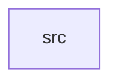

_Generated by CodeAtlas._

## Details

Owns 0 symbols across 1 file(s).

### src

Owns 26 symbols across 3 file(s).

**Related Classes/Methods:** _None_

**Source Files:**

- `crates/aurora-a11y/src/audit.rs`
  - `crates.aurora-a11y.src.audit.ContrastFinding`
  - `crates.aurora-a11y.src.audit.ThemeAuditReport`
  - `crates.aurora-a11y.src.audit.ThemeAuditReport.is_aa_compliant`
  - `crates.aurora-a11y.src.audit.ThemeAuditReport.is_aaa_compliant`
  - `crates.aurora-a11y.src.audit.ThemeAuditReport.text_failures`
  - `crates.aurora-a11y.src.audit.ThemeAuditReport.ui_failures`
  - `crates.aurora-a11y.src.audit.UiComponentFinding`
  - `crates.aurora-a11y.src.audit.audit_all_themes`
  - `crates.aurora-a11y.src.audit.audit_theme`
  - `crates.aurora-a11y.src.audit.tests.audit_all_themes_covers_all_four_themes`
  - `crates.aurora-a11y.src.audit.tests.audit_covers_every_semantic_pair`
  - `crates.aurora-a11y.src.audit.tests.core_reading_pairs_are_aaa_at_normal_text_size_in_every_theme`
  - `crates.aurora-a11y.src.audit.tests.every_theme_is_aa_compliant`
  - `crates.aurora-a11y.src.audit.tests.every_theme_is_aaa_compliant_for_large_text`
  - `crates.aurora-a11y.src.audit.tests.known_normal_text_aa_only_pairs_match_current_palette`
  - `crates.aurora-a11y.src.audit.tests.no_theme_fails_large_text_contrast_outright`
  - `crates.aurora-a11y.src.audit.tests.no_theme_fails_normal_text_contrast_outright`
  - `crates.aurora-a11y.src.audit.tests.no_theme_has_ui_component_failures`
- `crates/aurora-a11y/src/wcag.rs`
  - `crates.aurora-a11y.src.wcag.TextSize`
  - `crates.aurora-a11y.src.wcag.WcagLevel`
  - `crates.aurora-a11y.src.wcag.passes_ui_component_contrast`
  - `crates.aurora-a11y.src.wcag.tests.black_on_white_is_aaa_at_any_size`
  - `crates.aurora-a11y.src.wcag.tests.low_contrast_pair_fails_even_large_text`
  - `crates.aurora-a11y.src.wcag.tests.normal_text_requires_higher_ratio_than_large_text`
  - `crates.aurora-a11y.src.wcag.tests.ui_component_contrast_matches_1_4_11_threshold`
  - `crates.aurora-a11y.src.wcag.wcag_level`
