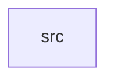

_Generated by CodeAtlas._

## Details

Owns 0 symbols across 1 file(s).

### src

Owns 68 symbols across 4 file(s).

**Related Classes/Methods:** _None_

**Source Files:**

- `crates/aurora-color/src/color.rs`
  - `crates.aurora-color.src.color.Color`
  - `crates.aurora-color.src.color.Color.contrast_ratio`
  - `crates.aurora-color.src.color.Color.from_hex`
  - `crates.aurora-color.src.color.Color.luminance`
  - `crates.aurora-color.src.color.Color.new`
  - `crates.aurora-color.src.color.Color.passes_wcag_aa`
  - `crates.aurora-color.src.color.Color.passes_wcag_aa_large`
  - `crates.aurora-color.src.color.Color.passes_wcag_aaa`
  - `crates.aurora-color.src.color.Color.passes_wcag_aaa_large`
  - `crates.aurora-color.src.color.Color.passes_wcag_ui_component`
  - `crates.aurora-color.src.color.Color.to_hex`
  - `crates.aurora-color.src.color.Color.to_rgb`
  - `crates.aurora-color.src.color.tests.test_color_contrast_ratio`
  - `crates.aurora-color.src.color.tests.test_color_default`
  - `crates.aurora-color.src.color.tests.test_color_equality`
  - `crates.aurora-color.src.color.tests.test_color_from_hex`
  - `crates.aurora-color.src.color.tests.test_color_luminance`
  - `crates.aurora-color.src.color.tests.test_color_new`
  - `crates.aurora-color.src.color.tests.test_color_to_hex`
  - `crates.aurora-color.src.color.tests.test_color_to_rgb`
  - `crates.aurora-color.src.color.tests.test_wcag_aa_contrast`
  - `crates.aurora-color.src.color.tests.test_wcag_aa_large_text_threshold_is_lower_than_aaa_large`
  - `crates.aurora-color.src.color.tests.test_wcag_aaa_contrast`
  - `crates.aurora-color.src.color.tests.test_wcag_aaa_large_text_threshold_is_lower_than_normal`
  - `crates.aurora-color.src.color.tests.test_wcag_ui_component_contrast`
- `crates/aurora-color/src/contrast.rs`
  - `crates.aurora-color.src.contrast.ContrastRatio`
  - `crates.aurora-color.src.contrast.check_contrast`
  - `crates.aurora-color.src.contrast.get_contrast_ratio`
  - `crates.aurora-color.src.contrast.tests.test_check_contrast_aa`
  - `crates.aurora-color.src.contrast.tests.test_check_contrast_aaa`
  - `crates.aurora-color.src.contrast.tests.test_contrast_symmetry`
  - `crates.aurora-color.src.contrast.tests.test_get_contrast_ratio`
  - `crates.aurora-color.src.contrast.tests.test_validate_dark_contrast`
  - `crates.aurora-color.src.contrast.tests.test_validate_light_contrast`
  - `crates.aurora-color.src.contrast.validate_contrast`
- `crates/aurora-color/src/lib.rs`
  - `crates.aurora-color.src.lib.AuroraColorSystem`
  - `crates.aurora-color.src.lib.AuroraColorSystem.colors`
  - `crates.aurora-color.src.lib.AuroraColorSystem.default`
  - `crates.aurora-color.src.lib.AuroraColorSystem.is_contrast_validated`
  - `crates.aurora-color.src.lib.AuroraColorSystem.new`
  - `crates.aurora-color.src.lib.AuroraColorSystem.set_theme`
  - `crates.aurora-color.src.lib.AuroraColorSystem.theme`
  - `crates.aurora-color.src.lib.AuroraColorSystem.to_css`
  - `crates.aurora-color.src.lib.tests.test_all_themes`
  - `crates.aurora-color.src.lib.tests.test_color_system_creation`
  - `crates.aurora-color.src.lib.tests.test_color_system_default`
  - `crates.aurora-color.src.lib.tests.test_contrast_validation`
  - `crates.aurora-color.src.lib.tests.test_css_generation`
  - `crates.aurora-color.src.lib.tests.test_theme_switching`
- `crates/aurora-color/src/theme.rs`
  - `crates.aurora-color.src.theme.ColorSystem`
  - `crates.aurora-color.src.theme.ColorSystem.dark`
  - `crates.aurora-color.src.theme.ColorSystem.from_theme`
  - `crates.aurora-color.src.theme.ColorSystem.hdr`
  - `crates.aurora-color.src.theme.ColorSystem.light`
  - `crates.aurora-color.src.theme.ColorSystem.oled`
  - `crates.aurora-color.src.theme.ColorSystem.theme`
  - `crates.aurora-color.src.theme.ColorSystem.to_css`
  - `crates.aurora-color.src.theme.Theme`
  - `crates.aurora-color.src.theme.Theme.name`
  - `crates.aurora-color.src.theme.Theme.new`
  - `crates.aurora-color.src.theme.ThemeName`
  - `crates.aurora-color.src.theme.tests.test_all_colors_present`
  - `crates.aurora-color.src.theme.tests.test_css_generation`
  - `crates.aurora-color.src.theme.tests.test_theme_contrast`
  - `crates.aurora-color.src.theme.tests.test_theme_dark`
  - `crates.aurora-color.src.theme.tests.test_theme_hdr`
  - `crates.aurora-color.src.theme.tests.test_theme_light`
  - `crates.aurora-color.src.theme.tests.test_theme_oled`
