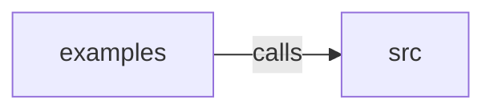

_Generated by CodeAtlas._

## Details

Owns 0 symbols across 1 file(s).

### examples

Owns 3 symbols across 2 file(s).

**Related Classes/Methods:** _None_

**Source Files:**

- `crates/aurora-gtk/examples/gtk4_harness.rs`
  - `crates.aurora-gtk.examples.gtk4_harness.main`
- `crates/aurora-gtk/examples/showcase.rs`
  - `crates.aurora-gtk.examples.showcase.build_ui`
  - `crates.aurora-gtk.examples.showcase.main`

### src

Owns 26 symbols across 4 file(s).

**Related Classes/Methods:** _None_

**Source Files:**

- `crates/aurora-gtk/src/css.rs`
  - `crates.aurora-gtk.src.css.CssProvider`
  - `crates.aurora-gtk.src.css.CssProvider.generate_css`
  - `crates.aurora-gtk.src.css.CssProvider.install`
  - `crates.aurora-gtk.src.css.CssProvider.new`
  - `crates.aurora-gtk.src.css.CssProvider.theme`
  - `crates.aurora-gtk.src.css.CssProvider.tokens`
  - `crates.aurora-gtk.src.css.tests.test_css_contains_motion_tokens`
  - `crates.aurora-gtk.src.css.tests.test_css_contains_theme_class`
  - `crates.aurora-gtk.src.css.tests.test_css_generation`
  - `crates.aurora-gtk.src.css.tests.test_css_provider_dark`
  - `crates.aurora-gtk.src.css.tests.test_css_provider_light`
- `crates/aurora-gtk/src/errors.rs`
  - `crates.aurora-gtk.src.errors.GtkError`
- `crates/aurora-gtk/src/lib.rs`
  - `crates.aurora-gtk.src.lib.AuroraGtk`
  - `crates.aurora-gtk.src.lib.AuroraGtk.css_provider`
  - `crates.aurora-gtk.src.lib.AuroraGtk.current_theme`
  - `crates.aurora-gtk.src.lib.AuroraGtk.default`
  - `crates.aurora-gtk.src.lib.AuroraGtk.get_css`
  - `crates.aurora-gtk.src.lib.AuroraGtk.new`
  - `crates.aurora-gtk.src.lib.AuroraGtk.set_theme`
  - `crates.aurora-gtk.src.lib.tests.test_aurora_gtk_creation`
  - `crates.aurora-gtk.src.lib.tests.test_aurora_gtk_css_generation`
  - `crates.aurora-gtk.src.lib.tests.test_aurora_gtk_default`
  - `crates.aurora-gtk.src.lib.tests.test_aurora_gtk_theme_switch`
- `crates/aurora-gtk/src/theme.rs`
  - `crates.aurora-gtk.src.theme.Theme`
  - `crates.aurora-gtk.src.theme.Theme.css_class`
  - `crates.aurora-gtk.src.theme.Theme.name`
