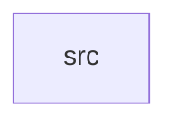

_Generated by CodeAtlas._

## Details

Owns 0 symbols across 1 file(s).

### src

Owns 16 symbols across 1 file(s).

**Related Classes/Methods:** _None_

**Source Files:**

- `crates/aurora-icons/src/lib.rs`
  - `crates.aurora-icons.src.lib.IconCategory`
  - `crates.aurora-icons.src.lib.IconCategory.fmt`
  - `crates.aurora-icons.src.lib.IconId`
  - `crates.aurora-icons.src.lib.IconId.category`
  - `crates.aurora-icons.src.lib.IconId.from_slug`
  - `crates.aurora-icons.src.lib.IconId.slug`
  - `crates.aurora-icons.src.lib.icon_body`
  - `crates.aurora-icons.src.lib.icon_svg`
  - `crates.aurora-icons.src.lib.tests.categories_cover_every_icon`
  - `crates.aurora-icons.src.lib.tests.category_display`
  - `crates.aurora-icons.src.lib.tests.every_icon_id_has_real_svg`
  - `crates.aurora-icons.src.lib.tests.from_slug_round_trips`
  - `crates.aurora-icons.src.lib.tests.icon_count_is_accurate_not_inflated`
  - `crates.aurora-icons.src.lib.tests.slugs_are_unique`
  - `crates.aurora-icons.src.lib.tests.wrap_helper_produces_valid_shell`
  - `crates.aurora-icons.src.lib.wrap`
