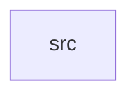

_Generated by CodeAtlas._

## Details

Owns 0 symbols across 1 file(s).

### src

Owns 115 symbols across 6 file(s).

**Related Classes/Methods:** _None_

**Source Files:**

- `crates/aurora-motion/src/animation.rs`
  - `crates.aurora-motion.src.animation.Animation`
  - `crates.aurora-motion.src.animation.Animation.advance`
  - `crates.aurora-motion.src.animation.Animation.current`
  - `crates.aurora-motion.src.animation.Animation.current_in_range`
  - `crates.aurora-motion.src.animation.Animation.elapsed_ms`
  - `crates.aurora-motion.src.animation.Animation.is_finished`
  - `crates.aurora-motion.src.animation.Animation.pause`
  - `crates.aurora-motion.src.animation.Animation.progress`
  - `crates.aurora-motion.src.animation.Animation.resume`
  - `crates.aurora-motion.src.animation.Animation.spring`
  - `crates.aurora-motion.src.animation.Animation.start`
  - `crates.aurora-motion.src.animation.Animation.tween`
  - `crates.aurora-motion.src.animation.Animation.with_delay`
  - `crates.aurora-motion.src.animation.Animation.with_gpu_acceleration`
  - `crates.aurora-motion.src.animation.AnimationState`
  - `crates.aurora-motion.src.animation.AnimationType`
  - `crates.aurora-motion.src.animation.tests.test_animation_advance`
  - `crates.aurora-motion.src.animation.tests.test_animation_completion`
  - `crates.aurora-motion.src.animation.tests.test_animation_current_in_range`
  - `crates.aurora-motion.src.animation.tests.test_animation_gpu_acceleration`
  - `crates.aurora-motion.src.animation.tests.test_animation_pause_resume`
  - `crates.aurora-motion.src.animation.tests.test_animation_start`
  - `crates.aurora-motion.src.animation.tests.test_animation_with_delay`
  - `crates.aurora-motion.src.animation.tests.test_spring_animation_creation`
  - `crates.aurora-motion.src.animation.tests.test_tween_animation_creation`
- `crates/aurora-motion/src/easing.rs`
  - `crates.aurora-motion.src.easing.EasingFunction`
  - `crates.aurora-motion.src.easing.EasingFunction.bounce_in`
  - `crates.aurora-motion.src.easing.EasingFunction.bounce_out`
  - `crates.aurora-motion.src.easing.EasingFunction.evaluate`
  - `crates.aurora-motion.src.easing.EasingFunction.material_ease_in_out`
  - `crates.aurora-motion.src.easing.EasingFunction.material_ease_out`
  - `crates.aurora-motion.src.easing.EasingFunction.to_css`
  - `crates.aurora-motion.src.easing.cubic_bezier`
  - `crates.aurora-motion.src.easing.tests.test_bounce_in`
  - `crates.aurora-motion.src.easing.tests.test_easing_clamping`
  - `crates.aurora-motion.src.easing.tests.test_easing_cubic_bezier`
  - `crates.aurora-motion.src.easing.tests.test_easing_ease_in`
  - `crates.aurora-motion.src.easing.tests.test_easing_ease_out`
  - `crates.aurora-motion.src.easing.tests.test_easing_linear`
  - `crates.aurora-motion.src.easing.tests.test_easing_to_css`
  - `crates.aurora-motion.src.easing.tests.test_material_ease_out`
- `crates/aurora-motion/src/errors.rs`
  - `crates.aurora-motion.src.errors.MotionError`
- `crates/aurora-motion/src/lib.rs`
  - `crates.aurora-motion.src.lib.MotionEngine`
  - `crates.aurora-motion.src.lib.MotionEngine.active_count`
  - `crates.aurora-motion.src.lib.MotionEngine.add_spring`
  - `crates.aurora-motion.src.lib.MotionEngine.add_tween`
  - `crates.aurora-motion.src.lib.MotionEngine.advance`
  - `crates.aurora-motion.src.lib.MotionEngine.all_finished`
  - `crates.aurora-motion.src.lib.MotionEngine.cleanup_finished`
  - `crates.aurora-motion.src.lib.MotionEngine.default`
  - `crates.aurora-motion.src.lib.MotionEngine.get`
  - `crates.aurora-motion.src.lib.MotionEngine.get_mut`
  - `crates.aurora-motion.src.lib.MotionEngine.new`
  - `crates.aurora-motion.src.lib.MotionEngine.pause`
  - `crates.aurora-motion.src.lib.MotionEngine.resume`
  - `crates.aurora-motion.src.lib.MotionEngine.start`
  - `crates.aurora-motion.src.lib.tests.test_motion_engine_add_spring`
  - `crates.aurora-motion.src.lib.tests.test_motion_engine_add_tween`
  - `crates.aurora-motion.src.lib.tests.test_motion_engine_advance`
  - `crates.aurora-motion.src.lib.tests.test_motion_engine_cleanup`
  - `crates.aurora-motion.src.lib.tests.test_motion_engine_creation`
  - `crates.aurora-motion.src.lib.tests.test_motion_engine_get`
  - `crates.aurora-motion.src.lib.tests.test_motion_engine_start_pause_resume`
- `crates/aurora-motion/src/spring.rs`
  - `crates.aurora-motion.src.spring.SpringAnimator`
  - `crates.aurora-motion.src.spring.SpringAnimator.advance`
  - `crates.aurora-motion.src.spring.SpringAnimator.current`
  - `crates.aurora-motion.src.spring.SpringAnimator.current_in_range`
  - `crates.aurora-motion.src.spring.SpringAnimator.elapsed_ms`
  - `crates.aurora-motion.src.spring.SpringAnimator.is_finished`
  - `crates.aurora-motion.src.spring.SpringAnimator.new`
  - `crates.aurora-motion.src.spring.SpringAnimator.progress`
  - `crates.aurora-motion.src.spring.SpringConfig`
  - `crates.aurora-motion.src.spring.SpringConfig.bouncy`
  - `crates.aurora-motion.src.spring.SpringConfig.default`
  - `crates.aurora-motion.src.spring.SpringConfig.gentle`
  - `crates.aurora-motion.src.spring.SpringConfig.snappy`
  - `crates.aurora-motion.src.spring.SpringConfig.standard`
  - `crates.aurora-motion.src.spring.SpringConfig.stiff`
  - `crates.aurora-motion.src.spring.SpringConfig.validate`
  - `crates.aurora-motion.src.spring.SpringState`
  - `crates.aurora-motion.src.spring.SpringState.is_at_rest`
  - `crates.aurora-motion.src.spring.SpringState.new`
  - `crates.aurora-motion.src.spring.SpringState.rest`
  - `crates.aurora-motion.src.spring.tests.test_spring_animator_animation`
  - `crates.aurora-motion.src.spring.tests.test_spring_animator_creation`
  - `crates.aurora-motion.src.spring.tests.test_spring_animator_progress`
  - `crates.aurora-motion.src.spring.tests.test_spring_animator_with_initial_velocity`
  - `crates.aurora-motion.src.spring.tests.test_spring_config_presets`
  - `crates.aurora-motion.src.spring.tests.test_spring_config_standard`
  - `crates.aurora-motion.src.spring.tests.test_spring_config_validation`
  - `crates.aurora-motion.src.spring.tests.test_spring_state_at_rest`
  - `crates.aurora-motion.src.spring.tests.test_spring_state_rest`
- `crates/aurora-motion/src/window.rs`
  - `crates.aurora-motion.src.window.WindowAnimation`
  - `crates.aurora-motion.src.window.WindowAnimation.advance`
  - `crates.aurora-motion.src.window.WindowAnimation.close`
  - `crates.aurora-motion.src.window.WindowAnimation.is_finished`
  - `crates.aurora-motion.src.window.WindowAnimation.maximize`
  - `crates.aurora-motion.src.window.WindowAnimation.minimize`
  - `crates.aurora-motion.src.window.WindowAnimation.opacity`
  - `crates.aurora-motion.src.window.WindowAnimation.open`
  - `crates.aurora-motion.src.window.WindowAnimation.position_offset`
  - `crates.aurora-motion.src.window.WindowAnimation.progress`
  - `crates.aurora-motion.src.window.WindowAnimation.scale`
  - `crates.aurora-motion.src.window.WindowAnimation.start`
  - `crates.aurora-motion.src.window.WindowAnimationConfig`
  - `crates.aurora-motion.src.window.WindowAnimationConfig.default`
  - `crates.aurora-motion.src.window.WindowEvent`
  - `crates.aurora-motion.src.window.WindowState`
  - `crates.aurora-motion.src.window.tests.test_window_animation_advance`
  - `crates.aurora-motion.src.window.tests.test_window_animation_config_default`
  - `crates.aurora-motion.src.window.tests.test_window_animation_opacity`
  - `crates.aurora-motion.src.window.tests.test_window_animation_scale`
  - `crates.aurora-motion.src.window.tests.test_window_close_animation`
  - `crates.aurora-motion.src.window.tests.test_window_minimize_animation`
  - `crates.aurora-motion.src.window.tests.test_window_open_animation`
