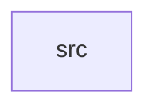

_Generated by CodeAtlas._

## Details

Owns 0 symbols across 1 file(s).

### src

Owns 44 symbols across 3 file(s).

**Related Classes/Methods:** _None_

**Source Files:**

- `crates/aurora-sound/src/feedback.rs`
  - `crates.aurora-sound.src.feedback.Feedback`
  - `crates.aurora-sound.src.feedback.SoundFeedback`
  - `crates.aurora-sound.src.feedback.SoundFeedback.a11y_announcement`
  - `crates.aurora-sound.src.feedback.SoundFeedback.default`
  - `crates.aurora-sound.src.feedback.SoundFeedback.feedback`
  - `crates.aurora-sound.src.feedback.SoundFeedback.new`
  - `crates.aurora-sound.src.feedback.SoundFeedback.sound`
  - `crates.aurora-sound.src.feedback.SoundFeedback.visual_feedback`
  - `crates.aurora-sound.src.feedback.tests.test_a11y_announcement`
  - `crates.aurora-sound.src.feedback.tests.test_all_feedback_types`
  - `crates.aurora-sound.src.feedback.tests.test_default_feedback`
  - `crates.aurora-sound.src.feedback.tests.test_sound_feedback_creation`
  - `crates.aurora-sound.src.feedback.tests.test_visual_feedback`
- `crates/aurora-sound/src/lib.rs`
  - `crates.aurora-sound.src.lib.AuroraSoundSystem`
  - `crates.aurora-sound.src.lib.AuroraSoundSystem.default`
  - `crates.aurora-sound.src.lib.AuroraSoundSystem.is_enabled`
  - `crates.aurora-sound.src.lib.AuroraSoundSystem.new`
  - `crates.aurora-sound.src.lib.AuroraSoundSystem.play`
  - `crates.aurora-sound.src.lib.AuroraSoundSystem.play_feedback`
  - `crates.aurora-sound.src.lib.AuroraSoundSystem.set_enabled`
  - `crates.aurora-sound.src.lib.AuroraSoundSystem.set_theme`
  - `crates.aurora-sound.src.lib.AuroraSoundSystem.set_volume`
  - `crates.aurora-sound.src.lib.AuroraSoundSystem.theme`
  - `crates.aurora-sound.src.lib.AuroraSoundSystem.volume`
  - `crates.aurora-sound.src.lib.tests.test_default`
  - `crates.aurora-sound.src.lib.tests.test_play_feedback`
  - `crates.aurora-sound.src.lib.tests.test_play_sound`
  - `crates.aurora-sound.src.lib.tests.test_sound_enabled_disabled`
  - `crates.aurora-sound.src.lib.tests.test_sound_system_creation`
  - `crates.aurora-sound.src.lib.tests.test_sound_system_volume`
  - `crates.aurora-sound.src.lib.tests.test_sound_theme`
  - `crates.aurora-sound.src.lib.tests.test_volume_clamping`
- `crates/aurora-sound/src/sound.rs`
  - `crates.aurora-sound.src.sound.Sound`
  - `crates.aurora-sound.src.sound.Sound.category`
  - `crates.aurora-sound.src.sound.Sound.duration_ms`
  - `crates.aurora-sound.src.sound.Sound.filename`
  - `crates.aurora-sound.src.sound.Sound.volume_for_theme`
  - `crates.aurora-sound.src.sound.SoundCategory`
  - `crates.aurora-sound.src.sound.SoundTheme`
  - `crates.aurora-sound.src.sound.tests.test_all_sounds`
  - `crates.aurora-sound.src.sound.tests.test_sound_category`
  - `crates.aurora-sound.src.sound.tests.test_sound_duration`
  - `crates.aurora-sound.src.sound.tests.test_sound_filename`
  - `crates.aurora-sound.src.sound.tests.test_volume_for_theme`
