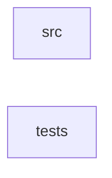

_Generated by CodeAtlas._

## Details

Owns 0 symbols across 1 file(s).

### src

Owns 99 symbols across 7 file(s).

**Related Classes/Methods:** _None_

**Source Files:**

- `crates/aurora-tokens/src/color.rs`
  - `crates.aurora-tokens.src.color.Color`
  - `crates.aurora-tokens.src.color.Color.contrast_ratio`
  - `crates.aurora-tokens.src.color.Color.from_hex`
  - `crates.aurora-tokens.src.color.Color.new`
  - `crates.aurora-tokens.src.color.Color.relative_luminance`
  - `crates.aurora-tokens.src.color.Color.to_hex`
  - `crates.aurora-tokens.src.color.Color.to_rgb`
  - `crates.aurora-tokens.src.color.Color.to_rgba`
  - `crates.aurora-tokens.src.color.ColorSystem`
  - `crates.aurora-tokens.src.color.ColorSystem.current`
  - `crates.aurora-tokens.src.color.ColorSystem.default`
  - `crates.aurora-tokens.src.color.ColorSystem.new`
  - `crates.aurora-tokens.src.color.ColorSystem.set_theme`
  - `crates.aurora-tokens.src.color.ColorSystem.theme`
  - `crates.aurora-tokens.src.color.ColorSystem.validate_contrast`
  - `crates.aurora-tokens.src.color.SemanticColor`
  - `crates.aurora-tokens.src.color.SemanticColor.dark`
  - `crates.aurora-tokens.src.color.SemanticColor.hdr`
  - `crates.aurora-tokens.src.color.SemanticColor.light`
  - `crates.aurora-tokens.src.color.SemanticColor.oled`
  - `crates.aurora-tokens.src.color.SemanticColor.validate_contrast`
  - `crates.aurora-tokens.src.color.Theme`
  - `crates.aurora-tokens.src.color.tests.test_color_from_hex`
  - `crates.aurora-tokens.src.color.tests.test_color_system_current_returns_the_real_hdr_palette_not_a_light_fallback`
  - `crates.aurora-tokens.src.color.tests.test_color_system_theme_switching`
  - `crates.aurora-tokens.src.color.tests.test_color_system_validate_contrast_covers_all_four_themes`
  - `crates.aurora-tokens.src.color.tests.test_color_to_hex`
  - `crates.aurora-tokens.src.color.tests.test_color_to_rgba`
  - `crates.aurora-tokens.src.color.tests.test_contrast_ratio`
  - `crates.aurora-tokens.src.color.tests.test_semantic_color_hdr_validation`
  - `crates.aurora-tokens.src.color.tests.test_semantic_color_light`
  - `crates.aurora-tokens.src.color.tests.test_semantic_color_validation`
- `crates/aurora-tokens/src/elevation.rs`
  - `crates.aurora-tokens.src.elevation.Elevation`
  - `crates.aurora-tokens.src.elevation.Elevation.dark`
  - `crates.aurora-tokens.src.elevation.Elevation.default`
  - `crates.aurora-tokens.src.elevation.Elevation.get_shadow`
  - `crates.aurora-tokens.src.elevation.Elevation.light`
  - `crates.aurora-tokens.src.elevation.ElevationLevel`
  - `crates.aurora-tokens.src.elevation.Shadow`
  - `crates.aurora-tokens.src.elevation.Shadow.to_css`
  - `crates.aurora-tokens.src.elevation.tests.test_dark_elevation`
  - `crates.aurora-tokens.src.elevation.tests.test_get_shadow`
  - `crates.aurora-tokens.src.elevation.tests.test_light_elevation`
  - `crates.aurora-tokens.src.elevation.tests.test_shadow_css_format`
- `crates/aurora-tokens/src/errors.rs`
  - `crates.aurora-tokens.src.errors.TokenError`
- `crates/aurora-tokens/src/lib.rs`
  - `crates.aurora-tokens.src.lib.DesignTokens`
  - `crates.aurora-tokens.src.lib.DesignTokens.default`
  - `crates.aurora-tokens.src.lib.DesignTokens.new`
  - `crates.aurora-tokens.src.lib.DesignTokens.set_theme`
  - `crates.aurora-tokens.src.lib.DesignTokens.theme`
  - `crates.aurora-tokens.src.lib.DesignTokens.to_json`
  - `crates.aurora-tokens.src.lib.DesignTokens.validate`
  - `crates.aurora-tokens.src.lib.tests.test_default_tokens_creation`
  - `crates.aurora-tokens.src.lib.tests.test_theme_switching`
  - `crates.aurora-tokens.src.lib.tests.test_tokens_to_json`
  - `crates.aurora-tokens.src.lib.tests.test_tokens_validation`
- `crates/aurora-tokens/src/motion.rs`
  - `crates.aurora-tokens.src.motion.AnimationDuration`
  - `crates.aurora-tokens.src.motion.AnimationDuration.css`
  - `crates.aurora-tokens.src.motion.AnimationDuration.ms`
  - `crates.aurora-tokens.src.motion.EasingFunction`
  - `crates.aurora-tokens.src.motion.EasingFunction.bounce_in`
  - `crates.aurora-tokens.src.motion.EasingFunction.material_ease_in_out`
  - `crates.aurora-tokens.src.motion.EasingFunction.material_ease_out`
  - `crates.aurora-tokens.src.motion.EasingFunction.to_css`
  - `crates.aurora-tokens.src.motion.MotionScale`
  - `crates.aurora-tokens.src.motion.MotionScale.default`
  - `crates.aurora-tokens.src.motion.MotionScale.get_duration`
  - `crates.aurora-tokens.src.motion.SpringConfig`
  - `crates.aurora-tokens.src.motion.SpringConfig.default`
  - `crates.aurora-tokens.src.motion.SpringConfig.gentle`
  - `crates.aurora-tokens.src.motion.SpringConfig.new`
  - `crates.aurora-tokens.src.motion.SpringConfig.snappy`
  - `crates.aurora-tokens.src.motion.tests.test_animation_duration_css`
  - `crates.aurora-tokens.src.motion.tests.test_animation_duration_ms`
  - `crates.aurora-tokens.src.motion.tests.test_easing_css_format`
  - `crates.aurora-tokens.src.motion.tests.test_easing_presets`
  - `crates.aurora-tokens.src.motion.tests.test_motion_scale_default`
  - `crates.aurora-tokens.src.motion.tests.test_spring_config_defaults`
  - `crates.aurora-tokens.src.motion.tests.test_spring_config_presets`
- `crates/aurora-tokens/src/radius.rs`
  - `crates.aurora-tokens.src.radius.Radius`
  - `crates.aurora-tokens.src.radius.Radius.from`
  - `crates.aurora-tokens.src.radius.Radius.new`
  - `crates.aurora-tokens.src.radius.Radius.px`
  - `crates.aurora-tokens.src.radius.Radius.rem`
  - `crates.aurora-tokens.src.radius.RadiusScale`
  - `crates.aurora-tokens.src.radius.RadiusScale.default`
  - `crates.aurora-tokens.src.radius.tests.test_default_radius_scale`
  - `crates.aurora-tokens.src.radius.tests.test_radius_px_format`
  - `crates.aurora-tokens.src.radius.tests.test_radius_rem_conversion`
- `crates/aurora-tokens/src/spacing.rs`
  - `crates.aurora-tokens.src.spacing.Spacing`
  - `crates.aurora-tokens.src.spacing.Spacing.from`
  - `crates.aurora-tokens.src.spacing.Spacing.new`
  - `crates.aurora-tokens.src.spacing.Spacing.px`
  - `crates.aurora-tokens.src.spacing.Spacing.rem`
  - `crates.aurora-tokens.src.spacing.SpacingScale`
  - `crates.aurora-tokens.src.spacing.SpacingScale.default`
  - `crates.aurora-tokens.src.spacing.tests.test_default_spacing_scale`
  - `crates.aurora-tokens.src.spacing.tests.test_spacing_px_format`
  - `crates.aurora-tokens.src.spacing.tests.test_spacing_rem_conversion`

### tests

Owns 3 symbols across 1 file(s).

**Related Classes/Methods:** _None_

**Source Files:**

- `crates/aurora-tokens/tests/workspace_metadata.rs`
  - `crates.aurora-tokens.tests.workspace_metadata.placeholder_crates_are_members_but_not_default_members`
  - `crates.aurora-tokens.tests.workspace_metadata.readme_documents_placeholder_crates`
  - `crates.aurora-tokens.tests.workspace_metadata.workspace_root`
