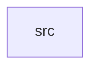

_Generated by CodeAtlas._

## Details

Owns 0 symbols across 1 file(s).

### src

Owns 101 symbols across 6 file(s).

**Related Classes/Methods:** _None_

**Source Files:**

- `crates/aurora-typography/src/errors.rs`
  - `crates.aurora-typography.src.errors.TypographyError`
- `crates/aurora-typography/src/font.rs`
  - `crates.aurora-typography.src.font.Font`
  - `crates.aurora-typography.src.font.Font.css_import`
  - `crates.aurora-typography.src.font.Font.fallback`
  - `crates.aurora-typography.src.font.Font.has_variant`
  - `crates.aurora-typography.src.font.Font.has_weight`
  - `crates.aurora-typography.src.font.Font.ibm_plex_sans`
  - `crates.aurora-typography.src.font.Font.inter`
  - `crates.aurora-typography.src.font.Font.new`
  - `crates.aurora-typography.src.font.Font.noto_sans`
  - `crates.aurora-typography.src.font.FontFamily`
  - `crates.aurora-typography.src.font.FontFamily.css_name`
  - `crates.aurora-typography.src.font.FontFamily.fallback_chain`
  - `crates.aurora-typography.src.font.FontFamily.name`
  - `crates.aurora-typography.src.font.FontFamily.url`
  - `crates.aurora-typography.src.font.FontVariant`
  - `crates.aurora-typography.src.font.FontVariant.css`
  - `crates.aurora-typography.src.font.FontWeight`
  - `crates.aurora-typography.src.font.FontWeight.css`
  - `crates.aurora-typography.src.font.FontWeight.value`
  - `crates.aurora-typography.src.font.tests.test_font_css_import`
  - `crates.aurora-typography.src.font.tests.test_font_fallback_chain`
  - `crates.aurora-typography.src.font.tests.test_font_family_css_name`
  - `crates.aurora-typography.src.font.tests.test_font_family_names`
  - `crates.aurora-typography.src.font.tests.test_font_has_weight`
  - `crates.aurora-typography.src.font.tests.test_font_inter`
  - `crates.aurora-typography.src.font.tests.test_font_variant_css`
  - `crates.aurora-typography.src.font.tests.test_font_weight_css`
  - `crates.aurora-typography.src.font.tests.test_font_weight_value`
- `crates/aurora-typography/src/lib.rs`
  - `crates.aurora-typography.src.lib.Typography`
  - `crates.aurora-typography.src.lib.Typography.adjust_for_script`
  - `crates.aurora-typography.src.lib.Typography.default`
  - `crates.aurora-typography.src.lib.Typography.get_style`
  - `crates.aurora-typography.src.lib.Typography.new`
  - `crates.aurora-typography.src.lib.Typography.optimal_line_length`
  - `crates.aurora-typography.src.lib.Typography.to_json`
  - `crates.aurora-typography.src.lib.Typography.validate`
  - `crates.aurora-typography.src.lib.tests.test_get_style_at_viewport`
  - `crates.aurora-typography.src.lib.tests.test_optimal_line_length`
  - `crates.aurora-typography.src.lib.tests.test_script_adjustment`
  - `crates.aurora-typography.src.lib.tests.test_typography_creation`
  - `crates.aurora-typography.src.lib.tests.test_typography_to_json`
  - `crates.aurora-typography.src.lib.tests.test_typography_validation`
- `crates/aurora-typography/src/responsive.rs`
  - `crates.aurora-typography.src.responsive.Breakpoint`
  - `crates.aurora-typography.src.responsive.Breakpoint.min_width`
  - `crates.aurora-typography.src.responsive.Breakpoint.name`
  - `crates.aurora-typography.src.responsive.ResponsiveScale`
  - `crates.aurora-typography.src.responsive.ResponsiveScale.for_breakpoint`
  - `crates.aurora-typography.src.responsive.ResponsiveScale.for_viewport`
  - `crates.aurora-typography.src.responsive.ResponsiveScale.new`
  - `crates.aurora-typography.src.responsive.ResponsiveTypography`
  - `crates.aurora-typography.src.responsive.ResponsiveTypography.apply_responsive_adjustments`
  - `crates.aurora-typography.src.responsive.ResponsiveTypography.default`
  - `crates.aurora-typography.src.responsive.ResponsiveTypography.to_css`
  - `crates.aurora-typography.src.responsive.ResponsiveTypography.validate`
  - `crates.aurora-typography.src.responsive.ViewportSize`
  - `crates.aurora-typography.src.responsive.ViewportSize.breakpoint`
  - `crates.aurora-typography.src.responsive.ViewportSize.diagonal_inches`
  - `crates.aurora-typography.src.responsive.ViewportSize.new`
  - `crates.aurora-typography.src.responsive.tests.test_responsive_css`
  - `crates.aurora-typography.src.responsive.tests.test_responsive_scale`
  - `crates.aurora-typography.src.responsive.tests.test_responsive_typography_default`
  - `crates.aurora-typography.src.responsive.tests.test_responsive_typography_validation`
  - `crates.aurora-typography.src.responsive.tests.test_viewport_breakpoint`
  - `crates.aurora-typography.src.responsive.tests.test_viewport_diagonal`
- `crates/aurora-typography/src/scale.rs`
  - `crates.aurora-typography.src.scale.TextLevel`
  - `crates.aurora-typography.src.scale.TextLevel.name`
  - `crates.aurora-typography.src.scale.TypeScale`
  - `crates.aurora-typography.src.scale.TypeScale.default`
  - `crates.aurora-typography.src.scale.TypeScale.get_style`
  - `crates.aurora-typography.src.scale.TypeScale.new`
  - `crates.aurora-typography.src.scale.TypeScale.to_css`
  - `crates.aurora-typography.src.scale.TypeScale.validate`
  - `crates.aurora-typography.src.scale.TypographyStyle`
  - `crates.aurora-typography.src.scale.TypographyStyle.letter_spacing_em`
  - `crates.aurora-typography.src.scale.TypographyStyle.line_height_pixels`
  - `crates.aurora-typography.src.scale.TypographyStyle.new`
  - `crates.aurora-typography.src.scale.TypographyStyle.to_css`
  - `crates.aurora-typography.src.scale.tests.test_get_style`
  - `crates.aurora-typography.src.scale.tests.test_line_height_pixels`
  - `crates.aurora-typography.src.scale.tests.test_size_ordering`
  - `crates.aurora-typography.src.scale.tests.test_to_css`
  - `crates.aurora-typography.src.scale.tests.test_type_scale_default`
  - `crates.aurora-typography.src.scale.tests.test_type_scale_validation`
  - `crates.aurora-typography.src.scale.tests.test_typography_style_creation`
  - `crates.aurora-typography.src.scale.tests.test_typography_style_invalid_size`
- `crates/aurora-typography/src/script.rs`
  - `crates.aurora-typography.src.script.Script`
  - `crates.aurora-typography.src.script.Script.adjustment`
  - `crates.aurora-typography.src.script.Script.detect`
  - `crates.aurora-typography.src.script.Script.name`
  - `crates.aurora-typography.src.script.Script.optimal_line_length`
  - `crates.aurora-typography.src.script.ScriptAdjustment`
  - `crates.aurora-typography.src.script.ScriptAdjustment.new`
  - `crates.aurora-typography.src.script.tests.test_script_adjustment_cjk`
  - `crates.aurora-typography.src.script.tests.test_script_adjustment_devanagari`
  - `crates.aurora-typography.src.script.tests.test_script_adjustment_latin`
  - `crates.aurora-typography.src.script.tests.test_script_detection_cjk`
  - `crates.aurora-typography.src.script.tests.test_script_detection_latin`
  - `crates.aurora-typography.src.script.tests.test_script_detection_rtl`
  - `crates.aurora-typography.src.script.tests.test_script_names`
  - `crates.aurora-typography.src.script.tests.test_script_optimal_line_length`
