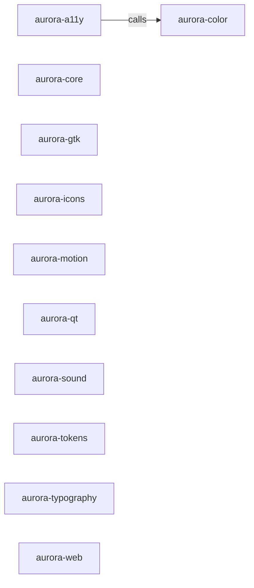

_Generated by CodeAtlas._

## Details

Owns 0 symbols across 0 file(s).

### aurora-a11y

Owns 0 symbols across 1 file(s).

**Related Classes/Methods:** _None_

### aurora-color

Owns 0 symbols across 1 file(s).

**Related Classes/Methods:** _None_

### aurora-core

Owns 0 symbols across 1 file(s).

**Related Classes/Methods:** _None_

### aurora-gtk

Owns 0 symbols across 1 file(s).

**Related Classes/Methods:** _None_

### aurora-icons

Owns 0 symbols across 1 file(s).

**Related Classes/Methods:** _None_

### aurora-motion

Owns 0 symbols across 1 file(s).

**Related Classes/Methods:** _None_

### aurora-qt

Owns 0 symbols across 1 file(s).

**Related Classes/Methods:** _None_

### aurora-sound

Owns 0 symbols across 1 file(s).

**Related Classes/Methods:** _None_

### aurora-tokens

Owns 0 symbols across 1 file(s).

**Related Classes/Methods:** _None_

### aurora-typography

Owns 0 symbols across 1 file(s).

**Related Classes/Methods:** _None_

### aurora-web

Owns 0 symbols across 1 file(s).

**Related Classes/Methods:** _None_
