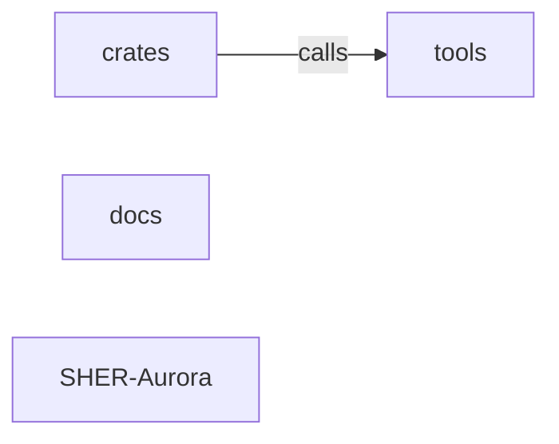

_Generated by CodeAtlas._

## Details

Architecture map of SHER-Aurora.

### crates

Owns 0 symbols across 0 file(s).

**Related Classes/Methods:** _None_

### docs

Owns 0 symbols across 0 file(s).

**Related Classes/Methods:** _None_

### tools

Owns 0 symbols across 0 file(s).

**Related Classes/Methods:** _None_

### SHER-Aurora

Owns 0 symbols across 11 file(s).

**Related Classes/Methods:** _None_
